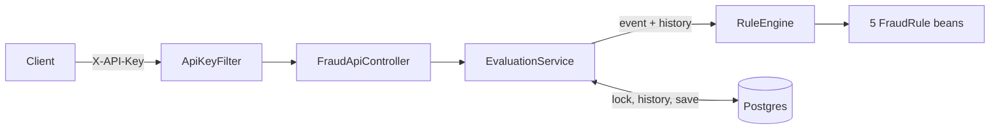

# Fraud Rule Engine

[](https://github.com/RossouwMaritz/fraud-rule-engine/actions/workflows/ci.yml)

## What it is

A Spring Boot service that takes card transaction events, runs each one through a set of configurable fraud rules, and stores the decision with a readable reason for every rule that fired. It **flags** transactions for review and never blocks them.

## Quick start

You need Docker. `send.sh` also needs `curl` and `jq`.

```bash
cp .env.example .env
docker compose up --build -d --wait   # returns once the app is healthy
./samples/send.sh
```

`send.sh` posts the 21 events in `samples/transactions.json` in order. It prints each decision and the rules that fired. If every decision matches the expected one, it exits with `0`. If any doesn't, it exits with `1`. The API key, `local-dev-key`, comes from `.env`. It moves every `occurredAt` so the last event lands at midnight (UTC) today, keeping the gaps between events, because the app rejects events more than 45 days old. Running it again the same day replays the stored results. On a later day, start from an empty database first: `docker compose down -v`.

To score one transaction yourself, run the command below. Amounts are in minor units (cents for ZAR), so `6000000` is R60,000.00. `occurredAt` must be in the last 45 days, so move it to a recent time if this one has aged out.

```bash
curl -i http://localhost:8080/api/v1/transactions \
  -H 'X-API-Key: local-dev-key' -H 'Content-Type: application/json' \
  -d '{"transactionId": "txn_readme_01", "customerId": "cus_readme", "cardId": "card_readme",
       "amountMinor": 6000000, "currency": "ZAR", "merchantId": "mer_casino", "merchantCategory": "GAMBLING",
       "channel": "ONLINE", "merchantCountry": "ZA", "occurredAt": "2026-10-19T10:00:00Z"}'
```

```http
HTTP/1.1 201
Location: /api/v1/transactions/txn_readme_01

{
  "transactionId": "txn_readme_01",
  "decision": "REVIEW",
  "totalScore": 60,
  "hits": [
    {"ruleId": "HIGH_AMOUNT", "score": 40, "reason": "ZAR 60,000.00 is over the ZAR 50,000.00 limit"},
    {"ruleId": "HIGH_RISK_CATEGORY", "score": 20, "reason": "Merchant category GAMBLING is on the high-risk list"}
  ],
  "rulesErrored": [],
  "configVersion": "ee11bf40c8cf"
}
```

Then list everything that was flagged: `curl -H 'X-API-Key: local-dev-key' 'http://localhost:8080/api/v1/flags'`.

## Architecture



1. `ApiKeyFilter` checks the API key.
2. `FraudApiController` validates the request body.
3. `EvaluationService` opens one database transaction and locks the customer, so their events are scored one at a time (see [Design decisions](#design-decisions)).
4. If the transaction ID is already stored, it returns the stored result.
5. Otherwise it loads the history: the card's transactions within 10 minutes either side, the card's nearest card-present transaction before and after this one, and the average and spread of the customer's amounts on all their cards, in the same currency, over the 30 days before it.
6. `RuleEngine` runs every enabled rule, adds up the scores and picks a decision.
7. The service saves the transaction, the rules that fired and the config version, and commits.

Rules never touch the database, so each one is a plain unit test.

## Rules

| Rule ID | Fires when (defaults) | Score |
| --- | --- | --- |
| `HIGH_AMOUNT` | The amount is over its currency's limit: R50,000, $3,000, €3,000 or £2,500. There's no FX conversion. A currency with no limit configured always fires, so it goes to review instead of slipping through | 40 |
| `AMOUNT_ANOMALY` | The customer has at least 10 `CLEAN` transactions in this currency in the last 30 days, and this amount is far above their usual spend: more than their average plus 3 standard deviations. Flagged transactions are left out, so fraud can't raise the baseline. A repeat payment never fires (see below) | 50 |
| `VELOCITY` | More than 5 of the card's transactions in any 10 minutes that include this one. Stored transactions after it count too, so a burst that arrives out of order is still caught. Each card counts on its own, so a family sharing an account isn't one burst | 40 |
| `COUNTRY_HOP` | A card-present transaction in a different country from the same card's nearest card-present one before or after it, less than 2 hours apart. Online transactions never fire it | 80 |
| `HIGH_RISK_CATEGORY` | The merchant category is `GAMBLING`, `CRYPTO` or `MONEY_TRANSFER` | 20 |

**Decision.** The scores of all hits are added up. Under 40 is `CLEAN`, 40 to 79 is `REVIEW`, and 80 or more is `HIGH_RISK`. If a rule throws, it is logged and listed in `rulesErrored`, and the other rules still count. An event more than 45 days old is rejected with a `400` before any rule runs.

**Repeat payments.** Building the scenarios test showed that monthly rent got flagged. One large payment among many small ones always looks unusual. So `AMOUNT_ANOMALY` skips a payment with the same merchant, amount and currency as one 25 to 35 days earlier (35 covers a 31-day month). Without this check, the rent case in the scenarios test comes out `REVIEW`. The 25-day minimum means a fraudster can't clear a flagged amount by just paying it again straight away. And only a `CLEAN` earlier payment counts, so a flagged amount is still flagged a month later. The cost: a new recurring payment that was flagged the first time stays flagged every month, until an analyst workflow can mark it as fine.

**Tuning.** Every threshold, score and band is set by an environment variable. `src/main/resources/application.yml` holds the defaults as `${FRAUD_VELOCITY_MAX_COUNT:5}`, and nothing is hard-coded in Java. With Docker, set the variable in `.env`, which compose passes to the app. Restart the app after a change. A bad value (a negative score, a currency limit of zero, `high-risk-from` not above `review-from`) stops the app at startup. Durations take a unit: `10m`, `2h`, `30d`.

| Variable | Default | Meaning |
| --- | --- | --- |
| `FRAUD_API_KEY` | none, required | The key callers send in `X-API-Key` |
| `FRAUD_MAX_EVENT_AGE` | `45d` | An older `occurredAt` gets `400` |
| `FRAUD_REVIEW_FROM` | `40` | Lowest total score for `REVIEW` |
| `FRAUD_HIGH_RISK_FROM` | `80` | Lowest total score for `HIGH_RISK`. Must be above `FRAUD_REVIEW_FROM` |
| `FRAUD_HIGH_AMOUNT_ENABLED`, `_SCORE` | `true`, `40` | `HIGH_AMOUNT` on or off, and its score |
| `FRAUD_HIGH_AMOUNT_ZAR`, `_USD`, `_EUR`, `_GBP` | `5000000`, `300000`, `300000`, `250000` | Limits in minor units. Add a currency with `FRAUD_RULES_HIGHAMOUNT_THRESHOLDSMINOR_<CODE>` |
| `FRAUD_AMOUNT_ANOMALY_ENABLED`, `_SCORE` | `true`, `50` | `AMOUNT_ANOMALY` on or off, and its score |
| `FRAUD_AMOUNT_ANOMALY_MIN_HISTORY` | `10` | `CLEAN` transactions needed before the rule can fire |
| `FRAUD_AMOUNT_ANOMALY_LOOKBACK` | `30d` | How far back the baseline goes |
| `FRAUD_AMOUNT_ANOMALY_STDDEV_MULTIPLIER` | `3` | Standard deviations above the average that count as unusual |
| `FRAUD_AMOUNT_ANOMALY_REPEAT_MIN_AGE`, `_MAX_AGE` | `25d`, `35d` | Window for a repeat payment that never fires |
| `FRAUD_VELOCITY_ENABLED`, `_SCORE` | `true`, `40` | `VELOCITY` on or off, and its score |
| `FRAUD_VELOCITY_MAX_COUNT` | `5` | Most transactions per card allowed in the window |
| `FRAUD_VELOCITY_WINDOW` | `10m` | The sliding window |
| `FRAUD_COUNTRY_HOP_ENABLED`, `_SCORE` | `true`, `80` | `COUNTRY_HOP` on or off, and its score |
| `FRAUD_COUNTRY_HOP_WINDOW` | `2h` | Card-present transactions in two countries closer than this fire |
| `FRAUD_HIGH_RISK_CATEGORY_ENABLED`, `_SCORE` | `true`, `20` | `HIGH_RISK_CATEGORY` on or off, and its score |
| `FRAUD_HIGH_RISK_CATEGORIES` | `GAMBLING,CRYPTO,MONEY_TRANSFER` | Comma-separated merchant categories |
| `SPRING_DATASOURCE_URL`, `_USERNAME`, `_PASSWORD` | none, required | The Postgres connection. Compose builds them from the `POSTGRES_*` values in `.env` |

`.env.example` lists every variable with its default. `GET /api/v1/rules` shows the config the app is running with.

**Config versions.** At startup the app hashes the bands and rules (SHA-256 of their JSON, first 12 hex characters) into a `configVersion`, logs it, and stores the config in the `rule_configs` table if it's new. Every decision stores the version it was made with, and the API returns it. So an auditor can look up the exact thresholds behind a decision months later:

```sql
select c.config from transactions t join rule_configs c on c.version = t.config_version
where t.transaction_id = 'txn_readme_01';
```

Decisions stored before versions existed point at `unknown`, whose config is `{}`. Reordering a list in `application.yml`, like the high-risk categories, gives a new version even though the rules work the same.

## Adding a rule

1. **Write the rule.** Add a `@Component` in `com.fraudengine.engine.rules` that implements `FraudRule`, with `id()`, `enabled()` and `evaluate()`. It must use only its arguments, with no I/O. `HighRiskCategoryRule` is the shortest example. `RuleEngine` picks it up automatically.
2. **Add its config.** Add a record to `FraudRulesProperties` with `enabled`, `score` and its thresholds, with validation annotations. Add it to `Rules`, and add the defaults to `application.yml`.
3. **Add its tests.** Add a `@ParameterizedTest` next to the others in `src/test/java/com/fraudengine/engine/rules`, covering just under, exactly at and just over the threshold, and empty history.

## API

Every `/api/**` call needs the `X-API-Key` header. A missing or wrong key gets `401`.

`cardId` is the issuer's token or reference for the card, never the card number. It is stored and returned as sent.

| Method and path | Response |
| --- | --- |
| `POST /api/v1/transactions` | `201` with the evaluation. Sending the same transaction again gets `200` with the stored result, and a reused ID with different details gets `409` (see [Idempotency](#design-decisions)) |
| `GET /api/v1/transactions/{id}` | `200` with the transaction and its evaluation, or `404` |
| `GET /api/v1/flags` | A page of `REVIEW` and `HIGH_RISK` transactions, newest first. Filters: `customerId`, `decision`, `ruleId`, `from` (inclusive), `to` (exclusive), `page`, `size` (max 100) |
| `GET /api/v1/rules` | The bands and rule config the app is running with, and its `configVersion` |

Errors use the standard JSON error format (RFC 9457), with `title`, `status` and `detail` fields. A validation `400` adds an `errors` list:

```json
{"title": "Bad Request", "status": 400, "detail": "Invalid request content.",
 "errors": [{"field": "currency", "message": "must match \"[A-Z]{3}\""}]}
```

Amounts are whole minor units (`125000` is R1,250.00), `currency` must be a real ISO 4217 code (`QQQ` gets a `400`), and `occurredAt` may be at most 5 minutes in the future and at most 45 days in the past (`fraud.max-event-age`). An older event gets a `400` on `occurredAt`.

Every response carries an `X-Request-Id` header. A caller's own ID is kept if it is 1 to 64 characters of `A-Z a-z 0-9 . _ -`, otherwise the app makes one. Logs are JSON (Elastic Common Schema), and every line from a request carries its `requestId`, so one request can be followed through the logs.

Swagger UI is at <http://localhost:8080/swagger-ui.html>. Click **Authorize** and enter the key to try calls. In production, turn the docs off with `springdoc.api-docs.enabled=false` and `springdoc.swagger-ui.enabled=false`. Health is at `/actuator/health` and needs no key. Prometheus metrics are at `/actuator/prometheus` and need the key.

## Testing

Tests need JDK 25 (check with `java -version`), or set `JAVA_HOME` to point at it.

```bash
./mvnw test     # unit and Spring tests
./mvnw verify   # the above, plus the FraudScenariosIT and RuleConfigVersionIT integration tests
```

The rule and engine tests are plain unit tests. The Spring tests start a throwaway Postgres 17 in Docker (using Testcontainers), so Docker must be running for both commands. To run only the tests that don't need Docker: `./mvnw test -Dtest='RuleEngineTest,FraudRulesPropertiesTest,*RuleTest'`.

`FraudScenariosIT` is the evidence that the engine works. It posts events through the real API, with the real database, at fixed timestamps, and checks the exact decision and rule IDs for every event:

| Scenario | Rules fired | Decision |
| --- | --- | --- |
| Card testing: 7 small charges in 4 minutes | `VELOCITY` from the 6th charge | `REVIEW` (the first 5 are `CLEAN`) |
| The same 7 charges arriving newest first | `VELOCITY` on the last 2 to arrive | `REVIEW` (the first 5 to arrive are `CLEAN`) |
| Card-present in ZA, then card-present in GB 40 minutes later | `COUNTRY_HOP` | `HIGH_RISK` |
| Card-present in GB, then a late card-present in ZA from 30 minutes before it | `COUNTRY_HOP` on the ZA one | `HIGH_RISK` |
| R60,000 at a gambling merchant | `HIGH_AMOUNT`, `HIGH_RISK_CATEGORY` | `REVIEW` |
| A spike against a steady history of 15 payments of R300 to R600 | `AMOUNT_ANOMALY` | `REVIEW` |
| That flagged spike paid again to the same merchant 30 days later | `AMOUNT_ANOMALY` (a flagged payment doesn't count as a repeat) | `REVIEW` |
| Monthly rent across a 31-day month | none | `CLEAN` |
| A normal grocery shop | none | `CLEAN` |
| One customer's 2 cards, 4 charges each in 10 minutes, then 3 more on one card | `VELOCITY` on that card's 6th and 7th | `REVIEW` (the first 9 are `CLEAN`) |
| An online US purchase straight after card-present in ZA | none | `CLEAN` |
| A real trip: card-present in ZA, then GB 11 hours later | none | `CLEAN` |

`EvaluationServiceTest` also checks concurrency and replays: 10 events for one customer, posted from parallel threads, give exactly 10 rows with `VELOCITY` on the 6th and later. The same event posted twice gives one row and the same result both times.

## Load test

`loadtest/fraud.js` is a [k6](https://k6.io) script. It runs in Docker against the compose stack, so there is nothing to install:

```bash
docker compose up --build --wait
docker run --rm --network fraud-rule-engine_default -v "$PWD/loadtest:/scripts" \
  --env-file .env grafana/k6:0.57.0 run /scripts/fraud.js
docker compose down -v   # afterwards: each run stores ~100k transactions and floods GET /flags
```

It runs two scenarios, one after the other, each with 50 virtual users posting as fast as they can for 30 seconds. "Many customers" uses a new customer for every request. "One customer" sends every request for the same customer. The table gives the range over 4 runs. Each run came after one warm-up run on a fresh stack, with the tables emptied between runs. The one-customer numbers swing by 2× from run to run, so take them as a range, not a figure:

| Scenario | Requests per second | p50 | p99 | Errors |
| --- | --- | --- | --- | --- |
| Many customers | 4,800 to 5,200 | 9 to 10 ms | 21 to 25 ms | 0 |
| One customer | 160 to 350 | 140 to 300 ms | 350 to 850 ms | 0 |

Machine: an Apple M3 Max laptop, with the app, Postgres and k6 all in one Rancher Desktop VM (14 CPUs, 8 GB). The laptop was busy with other work too (load average 7 to 14). Nothing was tuned. A real deployment, with Postgres on its own host, will give different numbers. k6 prints each scenario's rate over the whole 65-second run, so the table divides its request count by 30 seconds instead.

**One customer's events run one at a time.** This is on purpose: the advisory lock makes the `VELOCITY` count exact. 50 requests for one customer queue on that one lock, so each waits for the ones ahead of it. That's where the 140 to 300 ms comes from. Each request also gets slower as the card's history grows, because the history rules load every event in the window around it, and this test puts thousands of events on one card in 10 minutes. A real card doesn't come close to 160 events a second.

## Design decisions

- **Synchronous REST, no broker.** The caller gets the decision in the response, and one database transaction both evaluates and stores it. So there is no gap where an event is accepted but not yet scored, and no queue to run. If a caller's network drops, it simply retries, and the retry is safe (see Idempotency below).
- **An advisory lock per customer.** `VELOCITY` and `COUNTRY_HOP` read the card's other transactions, and `AMOUNT_ANOMALY` reads all of the customer's. If two events for one customer arrived at the same moment, each could miss the other. So each evaluation first takes a Postgres lock keyed on the customer ID (`pg_advisory_xact_lock`). It's a lock on a name, not on a table row, and Postgres releases it when the transaction commits. Events for one customer run one at a time, across all their cards, and different customers still run in parallel. No extra infrastructure is needed.
- **Event time, both ways.** Real feeds retry, batch and reorder events. So the history rules look at what happened on both sides of an event's `occurredAt`, not only at what arrived before it. A late event gets the flag itself. Decisions already stored are never changed, so an auditor always sees what the engine said at the time. Events more than 45 days old are rejected rather than scored, so a bad timestamp (from 1999, say) can't slip through.
- **Amounts in minor units.** Amounts are a `long` count of minor units (cents for ZAR), never `double`, so there is no rounding error. The database column is `bigint` with a `> 0` check.
- **Config in YAML.** Rules are code and thresholds are config. Keeping the config in `application.yml` means it is versioned and reviewed with the code, validated at startup, and readable at `GET /api/v1/rules`. Each decision records which version of it was used. Changing it needs a restart. That's a fair trade for a first version (see "What I'd add next").
- **A config version on every decision.** Thresholds change over time, and an auditor needs the ones that were live when a decision was made, not today's. So each decision stores a short hash of the config, and `rule_configs` keeps every config by its hash (see [Config versions](#rules)). A hash needs no one to remember to bump a version number.
- **Idempotency.** The transaction ID is the primary key. A repeat of a stored ID with the same details returns the stored result with `200` and is not evaluated again, so a retry can't double-count itself in `VELOCITY`. A repeat with different details gets `409`.

## Data and privacy

Each transaction stores its IDs (transaction, customer, card, merchant), amount and currency, merchant category, channel, merchant country, the time it happened and arrived, and the decision with its rule hits. There are no card numbers, names, addresses or contact details. `cardId` must be a token, never the card number (see [API](#api)). The `Evaluated` log line at `INFO` carries IDs, the decision, the score and the rules, never amounts.

There is no retention policy yet, and nothing deletes old rows. That's a decision for the bank. A starting point would be 13 months, to cover card dispute windows, after which rows are deleted or anonymised.

## What I'd add next

- **A broker with a dead-letter queue** (Kafka or SQS), for upstream systems that publish events instead of calling an API.
- **An analyst review workflow**, to assign, resolve and comment on flags. Resolved cases would also give labelled data.
- **City-level travel checks.** Country codes miss fast travel inside one country, like Cape Town to Johannesburg in an hour.
- **FX conversion to one base currency**, so `AMOUNT_ANOMALY` can use a customer's spend across currencies.
- **Hot reload** of thresholds without a restart.
- **ML scoring** as one more rule, next to the readable ones.
- **Real auth** (OAuth2 client credentials or mTLS) instead of one static API key.

## Versions

| | Version |
| --- | --- |
| Java | 25 |
| Spring Boot | 4.1.1 |
| PostgreSQL | 17 (`postgres:17` image, 17.11 when last run) |
| springdoc-openapi | 3.1.1 |
